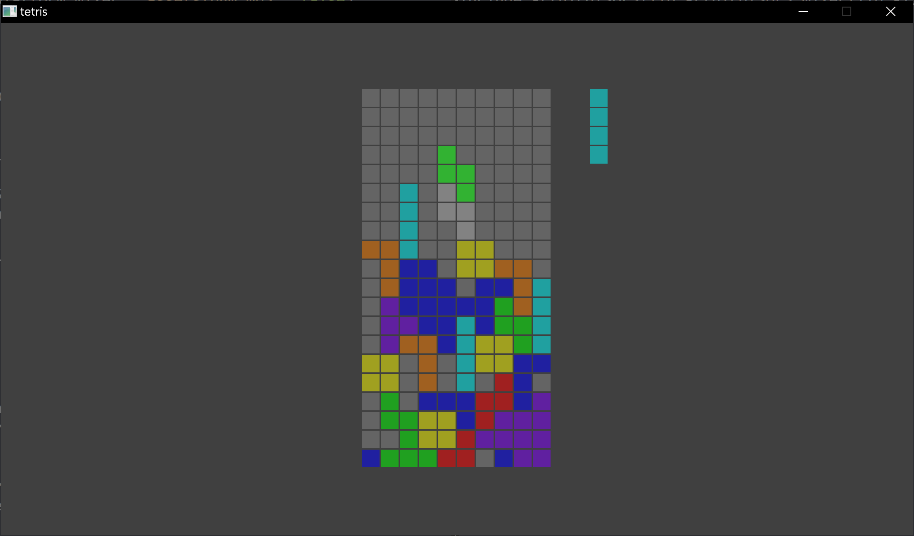

# Simple Tetris
a little pure c program tetris game  

## Build
make && make run  

## Third
SDL3  
SDL3_mixer  

## Keyboard
-a move left  
-d move right  
-w rotate  
-s soft down  
-space hard down

## Gamepad
-left move left  
-right move right  
-south rotate  
-down soft down  
-up hard down  

## Picture
  

## Notice
have no "Wall Kick" and "T-Spin"  
gamepad have a simple rumble  